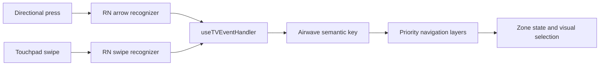

# Apple TV Remote swipe navigation

## Cause and scope

The native client uses manual navigation zones for Guide, settings, playback controls,
and modal pickers. `TvPressable` deliberately removes these controls from native TV
focus to prevent Select from activating both UIKit and the zone dispatcher. Setup
and login use native focus instead.

In pinned `react-native-tvos@0.83.6-0`, `RCTTVRemoteHandler` registers arrow-button
recognizers constrained to `UIPressType*Arrow` and separate UIKit swipe recognizers.
The latter emit `swipeUp`, `swipeDown`, `swipeLeft`, or `swipeRight` with a touch-event
body. `TVEventHandler` forwards them to the app's `useTVEventHandler` callback.
Airwave previously translated all four swipes to `unknown`; `dispatchKey` discarded
them before consulting a navigation layer. Direct execution of the production
translator reproduced this failure for all four directions.



Apple's native Focus Engine also handles indirect navigation, but non-focusable
zone controls cannot be its destinations. This patch restores recognized RN swipes
to the existing dispatcher on Apple TV only. It adds no recognizers, pan listener,
GameController access, dependency upgrades, or second navigation system. Native
focus screens remain native; non-tvOS input keeps its previous translation.

A complete native-focus migration would require synchronizing focus callbacks,
zone state, modal boundaries, and Select ownership across screens. Simply enabling
`focusable` would restore the duplicate actions documented in commit `db4a57b9`.
That migration is outside this patch. Earlier raw swipe mapping was removed in that
commit because of twitchy navigation; thumb-brush and duplicate-input checks below
are required before calling this fixed on hardware. No arbitrary time debounce is
added, since it could swallow deliberate rapid input.

Related report: [issue #16](https://github.com/Quixomatic/Airwave/issues/16).
The App Store 1.3 source revision and the exact events from a physical iPhone Remote
have not been independently established. Do not infer device success from unit tests.

## Automated checks

From the repository root:

```sh
pnpm --filter tv-native test
pnpm --filter tv-native check-types
git diff --check
```

`remote.test.ts` tests the production translator; the four Apple TV swipe cases fail
on the original implementation. Its isolated-process checks run the production
`useTVInput` callback and priority dispatcher, substituting React hook lifecycle,
RN event source/platform, and the optional keyboard module. They check one delivery
per recognized event, twenty rapid events, modal ownership/cleanup, retained button
and hold mappings, ignored focus/pan events, and Android/iPad swipe exclusion.
They do **not** reproduce real UIKit recognition, screen focus boundaries, native
focus restoration, playback, media grids, or iPhone transport. Those require the
simulator/device checks below. No native input code changes in this patch.

## Local validation status (11 October 2026)

- `pnpm --filter tv-native test`: **12 pass / 0 fail** remote checks. Original swipe translator: four expected failing cases.
- `pnpm --filter tv-native check-types`: **pass**. An initial test-only literal
  widening error was corrected; the final check passes.
- `git diff --check`: **pass**. No native-app lint/format script is configured.
- Root `pnpm check-types`: **fails outside this patch** after a full locked
  dependency install: unchanged desktop imports lack Electrobun declarations.
  A continued run also reports missing generated site/router files. The native
  app check passes; no dependency or unrelated source changes are included.
- Full Xcode 26.6 **Release tvOS 26.5 simulator build: pass**, using the local
  pinned-Babel lookup and matching Pods Hermes compiler workarounds described
  below. The installed app bundle uses Hermes bytecode 98 and excludes the
  development diagnostic label.
- Installed/launched the rebuilt Release app. Opened Device settings through a
  development deep link; keyboard navigation reached the settings rail and
  Select opened General settings; Back returned to the rail and Right restored
  content selection. This is a launch/button-input smoke check.
- Dragging the simulator display did not show a navigation change. The automation
  surface did not expose a usable remote touchpad. **No simulator swipe pass,
  simulator-native gesture-delivery pass is claimed.**
- **User-confirmed physical acceptance (11 October 2026): all physical Apple TV
  acceptance tests pass**, including the remote-navigation matrix below. These results were supplied by the user;
  the agent did not observe the physical test. Device/OS details and raw native
  traces were not supplied. Android/Fire TV and iPad device validation is separate
  from this Apple TV acceptance result.

## Install a development build on Apple TV

1. Put the Mac and Apple TV on the same local network. On Apple TV, open
   **Settings > Remotes and Devices > Remote App and Devices** and leave it open.
2. In Xcode, open **Device Hub** (Open Developer Tool > Device Hub, or Manage Devices
   from the run-destination picker). Older Xcode versions call this Devices and
   Simulators. Pair the discovered Apple TV and enter its displayed code yourself.
   Pairing exposes tvOS Developer Settings; follow any device-specific prompts.
3. Use Node 22+, pnpm 10.11.0, Xcode with the matching tvOS SDK, CocoaPods, CMake,
   and Ninja. Install the pinned workspace dependencies. If the native project is
   absent, run `EXPO_TV=1 pnpm --filter tv-native prebuild --platform ios`.
4. Open `apps/tv-native/ios/Airwave.xcworkspace`. Select the **Airwave** scheme and
   your **physical Apple TV**, not an iPhone/iPad or simulator.
5. In the generated app target's Signing & Capabilities, choose your development
   team and automatic signing. Sign into Xcode yourself if needed; do not share
   certificates, passwords, provisioning profiles, or signing keys.
6. To keep the installed App Store app intact, change only the ignored generated
   project's development bundle identifier to a unique identifier you own, and
   its display name to **Airwave Dev**. Do not commit signing or generated-project
   changes. This separate identifier intentionally has its own server/login data.
7. Use the Debug Run configuration. Start Metro from the repository root with
   `EXPO_TV=1 pnpm --filter tv-native dev`; keep it running and select that server
   in the development client if requested. Build and Run in Xcode to install.
   Configure the test build through its normal setup/login UI.
8. After Debug acceptance, repeat on a locally signed Release build. Release must
   bundle JS and use the Hermes compiler matching the Pods runtime. On the local
   validation environment, explicitly setting `HERMES_CLI_PATH` to
   `apps/tv-native/ios/Pods/hermes-engine/destroot/bin/hermesc` was required;
   `NODE_PATH` and a local link to the already-pinned Babel preset were also needed
   for the filtered pnpm layout. These are local tooling workarounds, not committed
   dependency or production signing changes.

Apple references: [device pairing](https://developer.apple.com/documentation/xcode/pairing-your-devices-with-your-mac),
[running on devices](https://developer.apple.com/documentation/xcode/running-your-app-on-simulated-or-physical-devices),
[focus interactions](https://developer.apple.com/documentation/uikit/about-focus-interactions-for-apple-tv),
and [focusable controls](https://developer.apple.com/documentation/uikit/adding-user-focusable-elements-to-a-tvos-app).

## Trace input without exposing private data

Debug builds log recognized swipe event type, semantic key, and handled/unhandled
status with the `[tv-input]` prefix. Release builds omit this `__DEV__` diagnostic.
Collect only those lines from Metro/Xcode, with a screen label you supply manually.
Do not share whole logs, private server addresses, credentials, or media metadata.

For native inspection, add Xcode symbolic breakpoints on
`-[RCTTVRemoteHandler swipedUp:]` (and Down/Left/Right), and `tappedUp:` (and other
arrow directions). Inspect recognizer state/direction only. A breakpoint on
`-[RCTViewComponentView didUpdateFocusInContext:withAnimationCoordinator:]` can
show whether a native-focus control changes; zone-driven controls instead update
JS state. A handled swipe with no visual movement at a boundary can be correct.
An unhandled swipe on native-focus setup/login can also be correct.

## Physical acceptance matrix

Record Apple TV model/tvOS, iPhone model/iOS, Debug or Release, and tested commit.
On iPhone, use Control Center's Apple TV Remote with its **default touchpad** first;
turn off the accessibility directional-button workaround for this pass.

The user confirmed on 11 October 2026 that all physical Apple TV tests pass.
The rows below record that confirmation; logs were not supplied. Repeat this
matrix on future changes or additional device/OS combinations.

| Input / context | Expected | Actual | Pass/fail | Safe logs |
| --- | --- | --- | --- | --- |
| Swipe up in Guide | Selection moves one row up | User-confirmed | Pass | Not supplied |
| Swipe down in Guide | Selection moves one row down | User-confirmed | Pass | Not supplied |
| Swipe left in Guide | Previous program/rail per existing zone rules | User-confirmed | Pass | Not supplied |
| Swipe right in Guide | Next program per existing zone rules | User-confirmed | Pass | Not supplied |
| Multiple rows/columns | Predictable selection and scrolling | User-confirmed | Pass | Not supplied |
| First/last item boundary | Stays at boundary or takes documented zone transition | User-confirmed | Pass | Not supplied |
| Settings rail and option rows | All directions navigate existing zones | User-confirmed | Pass | Not supplied |
| Open audio/subtitle/quality picker | Only modal handles navigation | User-confirmed | Pass | Not supplied |
| Dismiss picker with Back | Returns to underlying controls, no lost selection | User-confirmed | Pass | Not supplied |
| Select | Activates selected item exactly once | User-confirmed | Pass | Not supplied |
| Back within a panel | Returns to previous context | User-confirmed | Pass | Not supplied |
| Back at true Guide root | Existing exit-to-Home behavior | User-confirmed | Pass | Not supplied |
| Playback controls and scrubber | Navigation and hold scrubbing remain correct | User-confirmed | Pass | Not supplied |
| Play/Pause | Toggles once, without opening another action | User-confirmed | Pass | Not supplied |
| Twenty quick deliberate swipes | No swallowed input, duplicate steps, or unexpected jumps | User-confirmed | Pass | Not supplied |
| Rest thumb / small brush | No unintended navigation | User-confirmed | Pass | Not supplied |
| Setup/login native focus | Normal touchpad focus, Select once | User-confirmed | Pass | Not supplied |
| Leave and return to screen | Expected selection restoration | User-confirmed | Pass | Not supplied |

Repeat applicable rows with **iPhone accessibility buttons**, **physical Siri Remote
swipes**, and **physical directional clicks**. Check one movement per gesture and
one activation per Select; the RN source distinguishes these paths, but the actual
hardware event sequence must be measured. Repeat existing Android TV/Fire TV key
navigation and iPad touch/keyboard flows when devices are available. No new native
focus APIs or non-tvOS swipe handling are introduced.

Screens that are not present in this native client (for example a separate library
media grid or search screen) are not claimed tested. Use the Guide's rows/program
columns for the current grid-navigation acceptance.

Passing requires all four default iPhone touchpad directions to navigate without
accessibility buttons, with compatibility checks free of duplicate movement,
unexpected focus jumps, lost selection, and Select/Back/playback regressions.
Return only the matrix results and relevant `[tv-input]` lines. A recording is useful
if it avoids exposing private account/server/media information.
